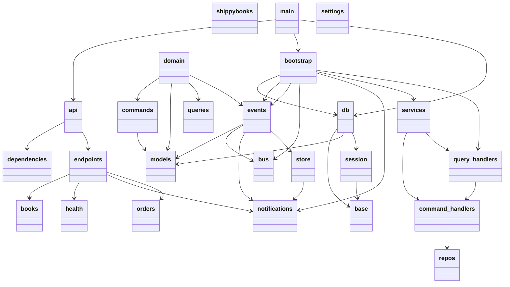
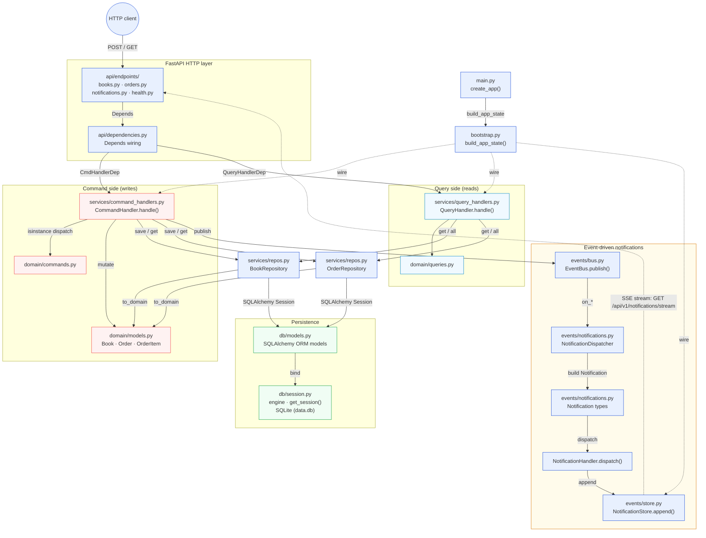

# shippybooks

See [ABOUT.md](ABOUT.md) for the project overview, architecture, and motivation.

## Project documentation

- [Architecture and API overview](ABOUT.md)
- [Class, project, and control-flow diagrams](diagrams/README.md)
- [Current implementation handoff](HANDOFF.md)

## Diagrams

### Class diagram

The class diagram shows the domain model, commands, queries, events, repositories, handlers, notification layer, and application wiring. Generated from `src/shippybooks` with `pyreverse` (Pylint). Source at `diagrams/classes.mmd`.

```mermaid
classDiagram
  class AppState {
    cmd_handler
    notification_store
    query_handler
  }
  class Base {
  }
  class Book {
    author : str
    id : str
    price : float
    stock : int
    title : str
    update_stock(quantity: int) None
  }
  class BookCreated {
    book
  }
  class BookNotification {
    book_id : str
    status : str
    stock : int
    to_event() dict[str, Any]
  }
  class BookORM {
    author
    id
    price
    stock
    title
    to_domain() Book
    update_from_domain(book: Book) None
  }
  class BookRepository {
    persistent_memory : bool
    session
    all() list[Book]
    get(id: str) Book
    save(book: Book) None
  }
  class BookUpdated {
    book
  }
  class ChangeOrderStatus {
    id : str
    new_status
  }
  class ChangeStatusRequest {
    status : str
  }
  class CheckResult {
    data : dict[str, Any] | None
    duration_ms : float
    message : str | None
    name : str
    required : bool
    status : Literal
  }
  class Command {
    model_config : ConfigDict
  }
  class CommandHandler {
    book_repo
    event_bus
    order_repo
    handle(command: Command) None
  }
  class Config {
    env_file : str
  }
  class CreateBook {
    author : str
    id : str
    price : float
    stock : int
    title : str
  }
  class CreateBookRequest {
    author : str
    price : float
    stock : int
    title : str
  }
  class CreateOrder {
    id : str
    items : list[OrderItem]
  }
  class CreateOrderRequest {
    items : list[OrderItem]
  }
  class DomainEvent {
  }
  class EventBus {
    publish(event: DomainEvent) None
    subscribe(event_type: type[DomainEvent], handler: Callable[..., None]) None
  }
  class GetBook {
    id : str
  }
  class GetOrder {
    id : str
  }
  class HealthResponse {
    check : Literal['live', 'ready', 'health']
    checks : list[CheckResult] | None
    duration_ms : float | None
    service : str
    status : Literal
    timestamp : str
    version : str
  }
  class ListBooks {
  }
  class ListOrders {
  }
  class Message {
    name
  }
  class Notification {
    to_event()* dict[str, Any]
  }
  class NotificationDispatcher {
    handler
    on_book_created(e: BookCreated) None
    on_book_updated(e: BookUpdated) None
    on_order_created(e: OrderCreated) None
    on_status_changed(e: OrderStatusChanged) None
  }
  class NotificationHandler {
    dispatch(notification: Notification) None
    register(notify_type: type[Notification], handler: Callable[[Notification], None]) None
  }
  class NotificationStore {
    append(notification: Notification) None
    since(last_id: int) list[dict[str, Any]]
  }
  class Order {
    id : str
    items : list[OrderItem]
    last_updated : datetime
    status
    timestamp : datetime
    total : float
    add_item(book: Book, quantity: int) None
    change_status(new_status: OrderStatus) None
  }
  class OrderConfirmation {
    order_id : str
    total : float
    to_event() dict[str, Any]
  }
  class OrderCreated {
    order
  }
  class OrderItem {
    book_id : str
    quantity : int
  }
  class OrderItemORM {
    book_id
    id
    order_id
    quantity
    to_domain() OrderItem
  }
  class OrderORM {
    id
    items
    last_updated
    status
    timestamp
    total
    to_domain() Order
  }
  class OrderRepository {
    persistent_memory : bool
    session
    all() list[Order]
    get(id: str) Order
    save(order: Order) None
  }
  class OrderStatus {
    name
  }
  class OrderStatusChanged {
    new_status
    old_status
    order_id : str
  }
  class Query {
    model_config : ConfigDict
  }
  class QueryHandler {
    book_repo
    order_repo
    handle(query: Query) Any
  }
  class Settings {
    database_url : str
    environment : str
    persistent_memory : bool
  }
  class StatusUpdate {
    new_status
    order_id : str
    to_event() dict[str, Any]
  }
  class StockAlert {
    book_id : str
    current_stock : int
    to_event() dict[str, Any]
  }
  class UpdateBookStock {
    id : str
    quantity : int
  }
  class UpdateStockRequest {
    book_id : str
    quantity : int
  }
  BookORM --|> Base
  OrderItemORM --|> Base
  OrderORM --|> Base
  ChangeOrderStatus --|> Command
  CreateBook --|> Command
  CreateOrder --|> Command
  UpdateBookStock --|> Command
  BookCreated --|> DomainEvent
  BookUpdated --|> DomainEvent
  OrderCreated --|> DomainEvent
  OrderStatusChanged --|> DomainEvent
  GetBook --|> Query
  GetOrder --|> Query
  ListBooks --|> Query
  ListOrders --|> Query
  BookNotification --|> Notification
  OrderConfirmation --|> Notification
  StatusUpdate --|> Notification
  StockAlert --|> Notification
  BookCreated --> Book : book
  BookUpdated --> Book : book
  OrderCreated --> Order : order
  ChangeOrderStatus --> OrderStatus : new_status
  OrderStatusChanged --> OrderStatus : old_status
  OrderStatusChanged --> OrderStatus : new_status
  StatusUpdate --> OrderStatus : new_status
  AppState --> NotificationStore : notification_store
  AppState --> CommandHandler : cmd_handler
  AppState --> QueryHandler : query_handler
  OrderStatus --o Order : status
  EventBus --o CommandHandler : event_bus
  NotificationHandler --o NotificationDispatcher : handler
  BookRepository --o CommandHandler : book_repo
  BookRepository --o QueryHandler : book_repo
  OrderRepository --o CommandHandler : order_repo
  OrderRepository --o QueryHandler : order_repo
```

View the rendered image: [diagrams/classes.png](diagrams/classes.png)

### Project diagram

The project diagram shows the `shippybooks` package structure, external dependencies, and runtime request flow between modules. Source at `diagrams/project.mmd`.

View the rendered image: [diagrams/project.png](diagrams/project.png)

### Control flow diagram

The control flow diagram shows the write path (commands), query path (reads), health probe path, event-driven notifications, and optional persistence. Rendered from `diagrams/control-flow.dot` with Graphviz `dot`. Source at `diagrams/control-flow.mmd`.

View the rendered image: [diagrams/control-flow.png](diagrams/control-flow.png)

## Reference material

[Arjan Codes - CQRS YT](https://www.youtube.com/watch?v=Spp-uzXzzdE)
[Arjan Codes - CQRS GH repo](https://github.com/ArjanCodes/examples/tree/main/2026/cqrs)
[G4G Outbox pattern](https://www.geeksforgeeks.org/system-design/outbox-pattern-for-reliable-messaging-system-design/)
[G4G Event-Driven Architecture](https://www.geeksforgeeks.org/system-design/event-driven-architecture-in-an-e-commerce-system/)
[G4G CQRS](https://www.geeksforgeeks.org/system-design/cqrs-command-query-responsibility-segregation/#google_vignette)
[A Practical Introduction to the Event Driven Architecture(GO)](https://dev.to/jimjunior/a-practical-introduction-to-the-event-driven-architecture-dol)
[Real-World Event Driven Architecture](https://streamkap.com/resources-and-guides/event-driven-architecture-examples)
[Event Sourcing with PostgreSQL](https://medium.com/@tobyhede/event-sourcing-with-postgresql-28c5e8f211a2)

[SQLAlchemy patterns](https://tessl.io/registry/tessl-labs/sqlalchemy-best-practices)
