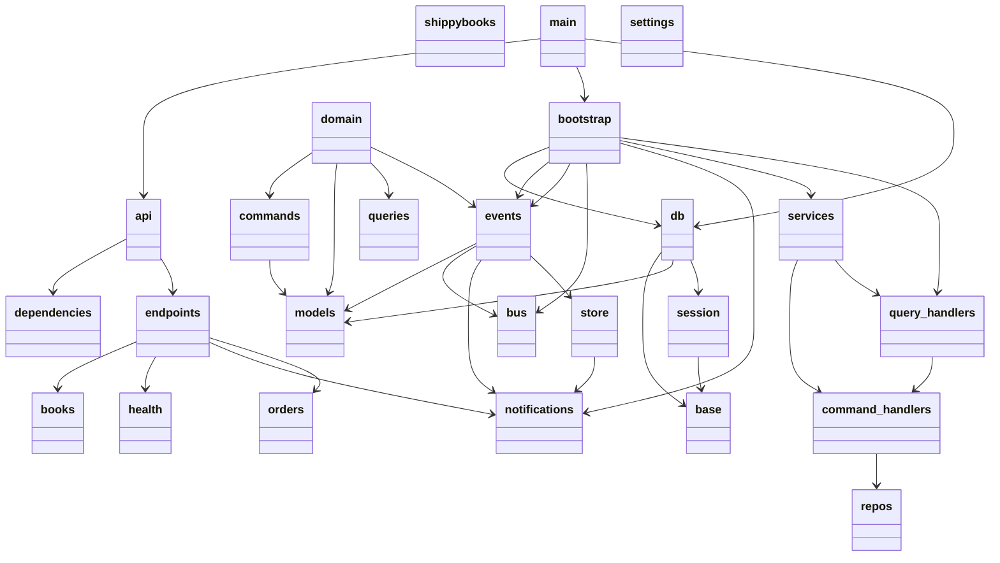

# shippybooks

See [ABOUT.md](ABOUT.md) for the project overview, architecture, and motivation.

## Project documentation

- [Architecture and API overview](ABOUT.md)
- [Class, project, and control-flow diagrams](diagrams/README.md)
- [Current implementation handoff](HANDOFF.md)

## Diagrams

### Class diagram

The class diagram shows the domain model, commands, queries, events, repositories, handlers, notification layer, and application wiring. Generated from `src/shippybooks` with `pyreverse` (Pylint). Source at `diagrams/classes.mmd`.

```mermaid
classDiagram
  class AppState {
    cmd_handler
    notification_store
    query_handler
  }
  class Base {
  }
  class Book {
    author : str
    id : str
    price : float
    stock : int
    title : str
    update_stock(quantity: int) None
  }
  class BookCreated {
    book
  }
  class BookNotification {
    book_id : str
    status : str
    stock : int
    to_event() dict[str, Any]
  }
  class BookORM {
    author
    id
    price
    stock
    title
    to_domain() Book
    update_from_domain(book: Book) None
  }
  class BookRepository {
    persistent_memory : bool
    session
    all() list[Book]
    get(id: str) Book
    save(book: Book) None
  }
  class BookUpdated {
    book
  }
  class ChangeOrderStatus {
    id : str
    new_status
  }
  class ChangeStatusRequest {
    status : str
  }
  class CheckResult {
    data : dict[str, Any] | None
    duration_ms : float
    message : str | None
    name : str
    required : bool
    status : Literal
  }
  class Command {
    model_config : ConfigDict
  }
  class CommandHandler {
    book_repo
    event_bus
    order_repo
    handle(command: Command) None
  }
  class Config {
    env_file : str
  }
  class CreateBook {
    author : str
    id : str
    price : float
    stock : int
    title : str
  }
  class CreateBookRequest {
    author : str
    price : float
    stock : int
    title : str
  }
  class CreateOrder {
    id : str
    items : list[OrderItem]
  }
  class CreateOrderRequest {
    items : list[OrderItem]
  }
  class DomainEvent {
  }
  class EventBus {
    publish(event: DomainEvent) None
    subscribe(event_type: type[DomainEvent], handler: Callable[..., None]) None
  }
  class GetBook {
    id : str
  }
  class GetOrder {
    id : str
  }
  class HealthResponse {
    check : Literal['live', 'ready', 'health']
    checks : list[CheckResult] | None
    duration_ms : float | None
    service : str
    status : Literal
    timestamp : str
    version : str
  }
  class ListBooks {
  }
  class ListOrders {
  }
  class Message {
    name
  }
  class Notification {
    to_event()* dict[str, Any]
  }
  class NotificationDispatcher {
    handler
    on_book_created(e: BookCreated) None
    on_book_updated(e: BookUpdated) None
    on_order_created(e: OrderCreated) None
    on_status_changed(e: OrderStatusChanged) None
  }
  class NotificationHandler {
    dispatch(notification: Notification) None
    register(notify_type: type[Notification], handler: Callable[[Notification], None]) None
  }
  class NotificationStore {
    append(notification: Notification) None
    since(last_id: int) list[dict[str, Any]]
  }
  class Order {
    id : str
    items : list[OrderItem]
    last_updated : datetime
    status
    timestamp : datetime
    total : float
    add_item(book: Book, quantity: int) None
    change_status(new_status: OrderStatus) None
  }
  class OrderConfirmation {
    order_id : str
    total : float
    to_event() dict[str, Any]
  }
  class OrderCreated {
    order
  }
  class OrderItem {
    book_id : str
    quantity : int
  }
  class OrderItemORM {
    book_id
    id
    order_id
    quantity
    to_domain() OrderItem
  }
  class OrderORM {
    id
    items
    last_updated
    status
    timestamp
    total
    to_domain() Order
  }
  class OrderRepository {
    persistent_memory : bool
    session
    all() list[Order]
    get(id: str) Order
    save(order: Order) None
  }
  class OrderStatus {
    name
  }
  class OrderStatusChanged {
    new_status
    old_status
    order_id : str
  }
  class Query {
    model_config : ConfigDict
  }
  class QueryHandler {
    book_repo
    order_repo
    handle(query: Query) Any
  }
  class Settings {
    database_url : str
    environment : str
    persistent_memory : bool
  }
  class StatusUpdate {
    new_status
    order_id : str
    to_event() dict[str, Any]
  }
  class StockAlert {
    book_id : str
    current_stock : int
    to_event() dict[str, Any]
  }
  class UpdateBookStock {
    id : str
    quantity : int
  }
  class UpdateStockRequest {
    book_id : str
    quantity : int
  }
  BookORM --|> Base
  OrderItemORM --|> Base
  OrderORM --|> Base
  ChangeOrderStatus --|> Command
  CreateBook --|> Command
  CreateOrder --|> Command
  UpdateBookStock --|> Command
  BookCreated --|> DomainEvent
  BookUpdated --|> DomainEvent
  OrderCreated --|> DomainEvent
  OrderStatusChanged --|> DomainEvent
  GetBook --|> Query
  GetOrder --|> Query
  ListBooks --|> Query
  ListOrders --|> Query
  BookNotification --|> Notification
  OrderConfirmation --|> Notification
  StatusUpdate --|> Notification
  StockAlert --|> Notification
  BookCreated --> Book : book
  BookUpdated --> Book : book
  OrderCreated --> Order : order
  ChangeOrderStatus --> OrderStatus : new_status
  OrderStatusChanged --> OrderStatus : old_status
  OrderStatusChanged --> OrderStatus : new_status
  StatusUpdate --> OrderStatus : new_status
  AppState --> NotificationStore : notification_store
  AppState --> CommandHandler : cmd_handler
  AppState --> QueryHandler : query_handler
  OrderStatus --o Order : status
  EventBus --o CommandHandler : event_bus
  NotificationHandler --o NotificationDispatcher : handler
  BookRepository --o CommandHandler : book_repo
  BookRepository --o QueryHandler : book_repo
  OrderRepository --o CommandHandler : order_repo
  OrderRepository --o QueryHandler : order_repo
```



View the rendered image: [diagrams/classes.png](diagrams/classes.png)

### Project diagram

The project diagram shows the `shippybooks` package structure, external dependencies, and runtime request flow between modules. Source at `diagrams/project.mmd`.



View the rendered image: [diagrams/project.png](diagrams/project.png)

### Control flow diagram

The control flow diagram shows the write path (commands), query path (reads), health probe path, event-driven notifications, and optional persistence. Rendered from `diagrams/control-flow.dot` with Graphviz `dot`. Source at `diagrams/control-flow.mmd`.

```mermaid
flowchart TD
    %% Auto-generated control flow diagram
    %% Source: scripts/gen_control_flow.py
    %% Edges marked [inferred] are not directly observable from AST

    classDef default fill:#e8f0fe,stroke:#1d4ed8,stroke-width:1px
    classDef endpoint fill:#f0f9ff,stroke:#0284c7,stroke-width:1px
    classDef handler fill:#fef2f2,stroke:#ef4444,stroke-width:1px
    classDef query fill:#f0f9ff,stroke:#0284c7,stroke-width:1px
    classDef repo fill:#f0fdf4,stroke:#16a34a,stroke-width:1px
    classDef bus fill:#fffbeb,stroke:#d97706,stroke-width:1px
    classDef db fill:#e0f2fe,stroke:#0369a1,stroke-width:1px

    Client(("HTTP client"))

    subgraph API ["FastAPI HTTP layer"]
        create_book["POST /books/
create_book"]:::endpoint
        update_stock["POST /books/{book_id}/stock/
update_stock"]:::endpoint
        get_book["GET /books/{book_id}
get_book"]:::endpoint
        list_books["GET /books/
list_books"]:::endpoint
        health_live["GET /health/live
health_live"]:::endpoint
        health_ready["GET /health/ready
health_ready"]:::endpoint
        health["GET /health
health"]:::endpoint
        notification_stream["GET /notifications/stream
notification_stream"]:::endpoint
        create_order["POST /orders/
create_order"]:::endpoint
        change_status["POST /orders/{order_id}/status/
change_status"]:::endpoint
        get_order["GET /orders/{order_id}
get_order"]:::endpoint
        list_orders["GET /orders/
list_orders"]:::endpoint
        _create_tables["ON_EVENT startup
_create_tables"]:::endpoint
    end

    Deps["api/dependencies.py
Depends wiring"]

    Main["main.py
create_app()"]
    Bootstrap["bootstrap.py
build_app_state()"]

    subgraph Command ["Command side (writes)"]
        CommandHandler___init__["CommandHandler.__init__"]:::handler
        CommandHandler_handle["CommandHandler.handle"]:::handler
        CommandHandler__create_book["CommandHandler._create_book"]:::handler
        CommandHandler__update_stock["CommandHandler._update_stock"]:::handler
        CommandHandler__create_order["CommandHandler._create_order"]:::handler
        CommandHandler__change_status["CommandHandler._change_status"]:::handler
    end

    subgraph Query ["Query side (reads)"]
        QueryHandler___init__["QueryHandler.__init__"]:::query
        QueryHandler_handle["QueryHandler.handle"]:::query
    end

    Repos["services/repos.py
BookRepository · OrderRepository"]:::repo

    subgraph Events ["Event-driven notifications"]
        style Events fill:#fffbeb,stroke:#d97706,stroke-width:1px
        EventBus___init__["EventBus.__init__"]:::bus
        EventBus_subscribe["EventBus.subscribe"]:::bus
        EventBus_publish["EventBus.publish"]:::bus
        NotificationDispatcher___init__["NotificationDispatcher.__init__"]:::bus
        NotificationDispatcher_on_book_created["NotificationDispatcher.on_book_created"]:::bus
        NotificationDispatcher_on_book_updated["NotificationDispatcher.on_book_updated"]:::bus
        NotificationDispatcher_on_order_created["NotificationDispatcher.on_order_created"]:::bus
        NotificationDispatcher_on_status_changed["NotificationDispatcher.on_status_changed"]:::bus
    end

    NH["NotificationHandler.dispatch()"]:::bus

    subgraph Persist ["Persistence"]
        ORM["db/models.py
SQLAlchemy ORM models"]:::db
        Session["db/session.py
engine · get_session()
SQLite (data.db)"]:::db
    end

    Store[("events/store.py
NotificationStore")]

    DM["domain/models.py
Book · Order · OrderItem"]
    DC["domain/commands.py
Command hierarchy"]
    DQ["domain/queries.py
Query hierarchy"]

    %% Runtime request flow
    Client -->|POST /books/| create_book
    Client -->|POST /books/{book_id}/stock/| update_stock
    Client -->|GET /books/{book_id}| get_book
    Client -->|GET /books/| list_books
    Client -->|GET /health/live| health_live
    Client -->|GET /health/ready| health_ready
    Client -->|GET /health| health
    Client -->|GET /notifications/stream| notification_stream
    Client -->|POST /orders/| create_order
    Client -->|POST /orders/{order_id}/status/| change_status
    Client -->|GET /orders/{order_id}| get_order
    Client -->|GET /orders/| list_orders
    Client -->|ON_EVENT startup| _create_tables

    %% Endpoint -> dependency wiring
    Deps -->|CmdHandlerDep| CommandHandler.handle
    Deps -->|QueryHandlerDep| QueryHandler.handle
    Main -->|build_app_state()| Bootstrap
    Bootstrap -.->|wire| CommandHandler.handle
    Bootstrap -.->|wire| QueryHandler.handle
    Bootstrap -.->|wire| Store

    %% Command side
    CommandHandler.handle -->|isinstance dispatch [inferred]| DC
    CommandHandler.handle -->|mutate| DM
    CommandHandler.handle -->|save / get| Repos

    %% Query side
    QueryHandler.handle -->|get / all| Repos
    QueryHandler.handle -->|to_domain()| DM

    %% Persistence
    Repos -->|SQLAlchemy Session| ORM
    ORM -->|bind| Session

    %% Event-driven notifications
    CommandHandler.handle -->|publish(event) [inferred]| EventBus.publish
    EventBus.publish -->|subscribe match [inferred]| NotificationDispatcher.on_*
    NotificationDispatcher.on_* -->|build Notification| NH
    NH -->|append()| Store

    %% SSE stream back to client
    Store -.->|SSE stream: GET /api/v1/notifications/stream [inferred]| Client
```

View the rendered image: [diagrams/control-flow.png](diagrams/control-flow.png)

## Reference material

[Arjan Codes - CQRS YT](https://www.youtube.com/watch?v=Spp-uzXzzdE)
[Arjan Codes - CQRS GH repo](https://github.com/ArjanCodes/examples/tree/main/2026/cqrs)
[G4G Outbox pattern](https://www.geeksforgeeks.org/system-design/outbox-pattern-for-reliable-messaging-system-design/)
[G4G Event-Driven Architecture](https://www.geeksforgeeks.org/system-design/event-driven-architecture-in-an-e-commerce-system/)
[G4G CQRS](https://www.geeksforgeeks.org/system-design/cqrs-command-query-responsibility-segregation/#google_vignette)
[A Practical Introduction to the Event Driven Architecture(GO)](https://dev.to/jimjunior/a-practical-introduction-to-the-event-driven-architecture-dol)
[Real-World Event Driven Architecture](https://streamkap.com/resources-and-guides/event-driven-architecture-examples)
[Event Sourcing with PostgreSQL](https://medium.com/@tobyhede/event-sourcing-with-postgresql-28c5e8f211a2)

[SQLAlchemy patterns](https://tessl.io/registry/tessl-labs/sqlalchemy-best-practices)
